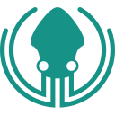

<picture>
  <source media="(prefers-reduced-motion: reduce)" srcset="./profile-banner.png">
  
</picture>

# Robert Ishimura Sousa

**AI Systems Engineer · Co-founder & CTO at DeltaEdge AI**

I started out building .NET applications and working with SQL Server. More than 20 years later, that experience still shapes how I build with AI. I start with the decision someone needs to make and work back to the data, software, and checks that will support it.

## What I’m building at DeltaEdge AI

We build and operate our own SaaS products. I help develop our **AI Operating System**, the tooling and workflows that connect product validation, engineering, and operations. We use agents to turn specifications into code, run checks, and document results. People review the work and decide what ships.

## From databases to data platforms

- **Production databases.** At Grupo Contax, I migrated a decade of legacy CRM data to a new platform. At UBS, I worked on production SQL Server reliability as a Level 3 DBA.
- **Data architecture.** I co-founded Dbaplex to help companies modernize their data platforms, from ingestion and storage on Azure to data models and reporting in Power BI.
- **Teaching.** As a Microsoft Certified Trainer, I delivered more than 2,000 hours of technical training, primarily in SQL Server and business intelligence, across New Horizons and Ka Solution.

## Stack I work with

<table width="100%">
  <tbody>
    <tr>
      <th colspan="6" scope="rowgroup" align="left">Data &amp; Analytics</th>
    </tr>
    <tr>
      <td colspan="2" width="33%" align="center"> SQL Server</td>
      <td colspan="2" width="33%" align="center"> PostgreSQL</td>
      <td colspan="2" width="33%" align="center"> Neon</td>
    </tr>
    <tr>
      <td colspan="2" width="33%" align="center"> T-SQL</td>
      <td colspan="2" width="33%" align="center"> Microsoft Fabric</td>
      <td colspan="2" width="33%" align="center"> Power BI</td>
    </tr>
  </tbody>
  <tbody>
    <tr>
      <th colspan="6" scope="rowgroup" align="left">Software Engineering</th>
    </tr>
    <tr>
      <td colspan="2" width="33%" align="center"> Python</td>
      <td colspan="2" width="33%" align="center"> TypeScript</td>
      <td colspan="2" width="33%" align="center"> JavaScript</td>
    </tr>
    <tr>
      <td colspan="2" width="33%" align="center"> C# / .NET</td>
      <td colspan="2" width="33%" align="center"> Node.js</td>
      <td colspan="2" width="33%" align="center"> FastAPI</td>
    </tr>
    <tr>
      <td colspan="2" width="33%" align="center"> Next.js</td>
      <td colspan="2" width="33%" align="center"> Visual Studio Code</td>
      <td colspan="2" width="33%" align="center"> Postman</td>
    </tr>
    <tr>
      <td colspan="2" width="33%" align="center"> Git</td>
      <td colspan="2" width="33%" align="center"> GitHub</td>
      <td colspan="2" width="33%" align="center"> Bitbucket</td>
    </tr>
    <tr>
      <td colspan="3" width="50%" align="center"> GitKraken</td>
      <td colspan="3" width="50%" align="center"> Linear</td>
    </tr>
  </tbody>
  <tbody>
    <tr>
      <th colspan="6" scope="rowgroup" align="left">AI &amp; Automation</th>
    </tr>
    <tr>
      <td colspan="2" width="33%" align="center"> OpenAI Codex</td>
      <td colspan="2" width="33%" align="center"> Cursor</td>
      <td colspan="2" width="33%" align="center"> GitHub Copilot</td>
    </tr>
    <tr>
      <td colspan="2" width="33%" align="center"><picture><source media="(prefers-color-scheme: dark)" srcset="./assets/stack/openai-dark.svg"></picture> OpenAI API</td>
      <td colspan="2" width="33%" align="center"> Hugging Face</td>
      <td colspan="2" width="33%" align="center"> GitHub Actions</td>
    </tr>
  </tbody>
  <tbody>
    <tr>
      <th colspan="6" scope="rowgroup" align="left">Cloud &amp; Infrastructure</th>
    </tr>
    <tr>
      <td colspan="2" width="33%" align="center"> Azure</td>
      <td colspan="2" width="33%" align="center"><picture><source media="(prefers-color-scheme: dark)" srcset="./assets/stack/aws-dark.svg"></picture> AWS</td>
      <td colspan="2" width="33%" align="center"> Google Cloud</td>
    </tr>
    <tr>
      <td colspan="2" width="33%" align="center"> Cloudflare</td>
      <td colspan="2" width="33%" align="center"> Docker</td>
      <td colspan="2" width="33%" align="center"> Coolify</td>
    </tr>
    <tr>
      <td colspan="3" width="50%" align="center"> Doppler</td>
      <td colspan="3" width="50%" align="center"> Resend</td>
    </tr>
  </tbody>
  <tbody>
    <tr>
      <th colspan="6" scope="rowgroup" align="left">Observability &amp; Quality</th>
    </tr>
    <tr>
      <td colspan="2" width="33%" align="center"> Sentry</td>
      <td colspan="2" width="33%" align="center"> Datadog</td>
      <td colspan="2" width="33%" align="center"> New Relic</td>
    </tr>
    <tr>
      <td colspan="6" width="100%" align="center"> Chromatic</td>
    </tr>
  </tbody>
</table>

## Selected work

- **Help4You.** A DeltaEdge AI product that helps neuropsychologists use their own references to draft reports for clinical review. [Explore Help4You](https://help4you.com.br/)
- **FIAP academic results API.** I took a business rule from a testable .NET service to an OpenAPI contract and a Docker release backed by xUnit, Postman, and GitHub Actions. [Explore the repository](https://github.com/robertishimurasousa/Fiap-Pos-Tech-5NETT-Fase3)

## Education & credentials

- **FIAP** · Postgraduate specialization in .NET Systems Architecture with Microsoft Azure
- **UNISUL** · Undergraduate technology degree in Information Technology Management
- **MIT xPRO** · Data Science and Big Data Analytics: Making Data-Driven Decisions
- **Udacity** · Nanodegrees in Data Science Foundations I and II and AI for Trading
- **Microsoft** · Fabric Analytics Engineer Associate (DP-600) and MCSE: Data Management and Analytics

---

[DeltaEdge AI Website](https://deltaedgeai.com.br/us) · [DeltaEdge AI GitHub](https://github.com/deltaedge-ai) · [LinkedIn](https://br.linkedin.com/in/robertishimurasousa) · [X](https://x.com/robertishimuras) · [Hugging Face](https://huggingface.co/robertishimurasousa)
